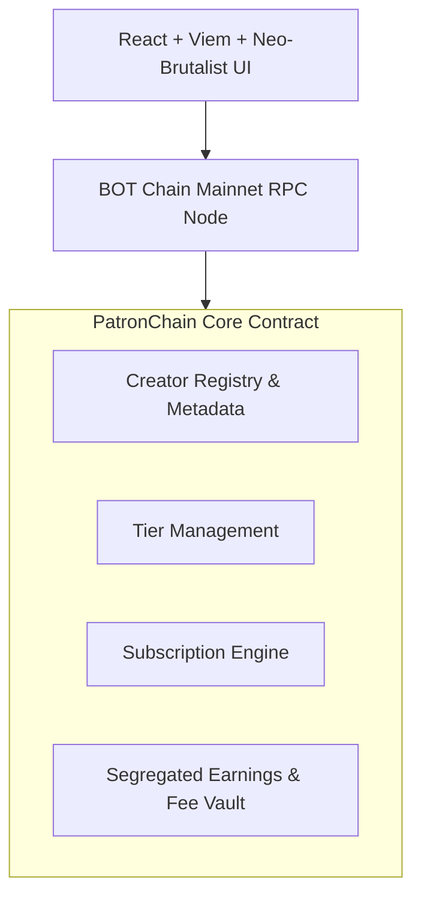

# PatronChain ⚡

> **Memberships that live on-chain.**  
> Decentralized, time-bound recurring subscription infrastructure natively built for **BOT Chain** (SocialFi + PayFi).

[-38EF7D?style=flat-square)](https://scan.botchain.ai)
[](https://soliditylang.org/)
[](https://viem.sh/)
[](LICENSE)

---

## 1. Product Overview

**PatronChain** bridges SocialFi and PayFi by providing a trustless, smart contract-driven recurring membership platform. It allows digital creators, artists, open-source developers, and communities to establish continuous on-chain funding in native **BOT** without relying on centralized intermediaries.

Traditional membership platforms charge 8–15% in platform cuts and payment processing fees, retain custodial control of user relationships, and arbitrarily freeze accounts. PatronChain replaces this with:
- **Immutable Single Source of Truth**: Creator profiles, tiers, subscriber entitlements, and expiration timestamps live strictly on the blockchain.
- **PayFi Engine**: Direct native BOT settlements with low protocol fees (2.5% default, capped at 10.0% max).
- **Time-Bound Verifiable Access**: An authoritative on-chain verification method (`verifyMembership`) that any third-party dApp, Discord bot, or gatekeeper API can query with zero API keys.
- **Aesthetic Neo-Brutalism**: High-contrast, vibrant, and tactile interface designed to delight both Web3 natives and mainstream audiences.

---

## 2. Verified BOT Chain Mainnet Deployment

The PatronChain core protocol is deployed, active, and fully verified on **BOT Chain Mainnet**:

| Parameter | Production Mainnet Value |
| :--- | :--- |
| **Network Name** | BOT Chain Mainnet |
| **Chain ID** | `677` (`0x2a5`) |
| **RPC Endpoint** | `https://rpc.botchain.ai` |
| **Block Explorer** | `https://scan.botchain.ai` |
| **Native Currency** | `BOT` (18 Decimals) |
| **Contract Address** | [`0xa5590be3e48dd445fa871fd813bce8f253a85439`](https://scan.botchain.ai/address/0xa5590be3e48dd445fa871fd813bce8f253a85439) |
| **Deployment Transaction** | [`0x54805fad8932be138b9e35a1bce166b17fd919dc7c31d02a1bbf94755723593d`](https://scan.botchain.ai/tx/0x54805fad8932be138b9e35a1bce166b17fd919dc7c31d02a1bbf94755723593d) |
| **Deployment Block** | `28825531` |
| **Gas Used** | `2,961,373` units |
| **Effective Gas Price** | `20 Gwei` (`20,000,000,000 wei`) |
| **Total BOT Spent** | `0.05922746 BOT` |
| **On-Chain Bytecode** | `12,979` bytes |
| **Owner Address** | `0x34090545BD562b0bE1Cdc855F7cA9beE4566CE51` |
| **Treasury Address** | `0x34090545BD562b0bE1Cdc855F7cA9beE4566CE51` |
| **Platform Fee** | `250` basis points (2.5%) |

---

## 3. Architecture & Key Primitives



### Key Mechanical Properties:
1. **Time-Bound Entitlements**: Subscriptions expire deterministically at `paidUntil`. Renewing before expiration adds full period duration to `paidUntil`.
2. **Cancellation Grace Period**: Cancelling flags `cancelled = true` to stop renewal intent, while granting uninterrupted access until `paidUntil`.
3. **Pull-Payment Pattern**: Creator earnings accumulate in internal balances and are withdrawn via `withdrawEarnings()` protected by OpenZeppelin's `ReentrancyGuard`.
4. **Solvency Guarantee**: $\text{contract.balance} \ge \text{accumulatedPlatformFees} + \sum \text{creatorBalances}$.

---

## 4. Quickstart & Local Development

### Prerequisites
- Node.js `^20.0.0` or `^24.0.0`
- Browser wallet (MetaMask, Rabby, Coinbase Wallet) configured for BOT Chain Mainnet

### Installation
```bash
# Clone the repository
git clone https://github.com/GoodnessTech/Patronchain.git
cd Patronchain

# Compile smart contracts
node scripts/compile.cjs

# Run on-chain mainnet audit
npm run test:onchain

# Start frontend development server
npm run dev

# Build production bundle
npm run build
```

### Environment Variables
Configure `.env`:
```env
VITE_ACTIVE_NETWORK=mainnet
VITE_CHAIN_ID=677
VITE_NETWORK_NAME=BOT Chain Mainnet
VITE_NATIVE_CURRENCY=BOT
VITE_RPC_URL=https://rpc.botchain.ai
VITE_EXPLORER_URL=https://scan.botchain.ai
VITE_PATRONCHAIN_CONTRACT_ADDRESS=0xa5590be3e48dd445fa871fd813bce8f253a85439
```

---

## 5. Integration Guide for Third-Party dApps

Integrators can verify subscriber status in real-time with zero backend dependencies:

```typescript
import { createPublicClient, http, parseAbi } from 'viem';

const client = createPublicClient({
  transport: http('https://rpc.botchain.ai'),
});

const PATRONCHAIN_ABI = parseAbi([
  'function verifyMembership(address creator, address supporter) external view returns (bool exists, bool isActive, uint256 tierId, uint256 startedAt, uint256 paidUntil, bool cancelled, uint256 totalPaid)',
]);

const [exists, isActive, tierId, startedAt, paidUntil, cancelled, totalPaid] = await client.readContract({
  address: '0xa5590be3e48dd445fa871fd813bce8f253a85439',
  abi: PATRONCHAIN_ABI,
  functionName: 'verifyMembership',
  args: [creatorAddress, supporterAddress],
});

if (isActive) {
  console.log(`Access active until ${new Date(Number(paidUntil) * 1000)}`);
}
```

---

## 6. Documentation Suite

Comprehensive technical specifications and reports are available in the [`docs/`](docs/) directory:
- [Mainnet Release Report](docs/MAINNET_RELEASE_REPORT.md)
- [Mainnet Deployment Details](docs/MAINNET_DEPLOYMENT.md)
- [Mainnet Verification Report](docs/MAINNET_VERIFICATION.md)
- [Mainnet Configuration Guide](docs/MAINNET_CONFIGURATION.md)
- [Mainnet Migration Audit](docs/MAINNET_MIGRATION_AUDIT.md)
- [System Architecture](docs/ARCHITECTURE.md)
- [Protocol Specification](docs/PROTOCOL_SPECIFICATION.md)
- [Security Specification & Threat Model](docs/SECURITY.md)
- [Third-Party Membership Verification Guide](docs/MEMBERSHIP_VERIFICATION.md)
- [Vercel Deployment Guide](docs/VERCEL_DEPLOYMENT.md)
- [Known Limitations & Roadmap](docs/KNOWN_LIMITATIONS.md)

---

## 7. Ecosystem Links

- **Botchain Official**: [https://www.botchain.ai/](https://www.botchain.ai/)
- **Botscan Explorer**: [https://scan.botchain.ai/](https://scan.botchain.ai/)
- **Authoritative Contract**: [`0xa5590be3e48dd445fa871fd813bce8f253a85439`](https://scan.botchain.ai/address/0xa5590be3e48dd445fa871fd813bce8f253a85439)

---

## 8. License

This project is open-source under the [MIT License](LICENSE).
