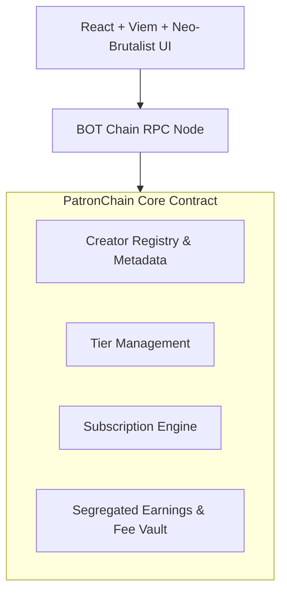

# PatronChain ⚡

> **Memberships that live on-chain.**  
> Decentralized, time-bound recurring subscription infrastructure natively built for **BOT Chain** (SocialFi + PayFi).

[](https://scan.bohr.life)
[-38EF7D?style=flat-square)](https://scan.botchain.ai)
[](https://soliditylang.org/)
[](https://viem.sh/)
[](LICENSE)

---

## 1. Product Overview

**PatronChain** bridges SocialFi and PayFi by providing a trustless, smart contract-driven recurring membership platform. It allows digital creators, artists, open-source developers, and communities to establish continuous on-chain funding in native **BOT** without relying on centralized intermediaries.

Traditional membership platforms charge 8–15% in platform cuts and payment processing fees, retain custodial control of user relationships, and arbitrarily freeze accounts. PatronChain replaces this with:
- **Immutable Single Source of Truth**: Creator profiles, tiers, subscriber entitlements, and expiration timestamps live strictly on the blockchain.
- **PayFi Engine**: Direct native BOT settlements with low protocol fees (2.5% default, capped at 10.0% max).
- **Time-Bound Verifiable Access**: An authoritative on-chain verification method (`verifyMembership`) that any third-party dApp, Discord bot, or gatekeeper API can query with zero API keys.
- **Aesthetic Neo-Brutalism**: High-contrast, vibrant, and tactile interface designed to delight both Web3 natives and mainstream audiences.

---

## 2. Verified Deployments & Networks

### 2.1 Live BOT Chain Testnet (Bohr)
The PatronChain core protocol is deployed, active, and fully verified on the BOT Chain Testnet:

| Parameter | Value |
| :--- | :--- |
| **Network Name** | BOT Chain Testnet (Bohr) |
| **Chain ID** | `968` |
| **RPC Endpoint** | `https://rpc.bohr.life` |
| **Block Explorer** | `https://scan.bohr.life` |
| **Native Currency** | `BOT` |
| **Contract Address** | [`0xb1ceb34818617a5b59c0d6ca98e2c4481b8a845f`](https://scan.bohr.life/address/0xb1ceb34818617a5b59c0d6ca98e2c4481b8a845f) |
| **Deployment Transaction** | [`0xe9e3579cf34f3217547f396cff4e15d031ed1d1f5bb07b114ccf5592e4504300`](https://scan.bohr.life/tx/0xe9e3579cf34f3217547f396cff4e15d031ed1d1f5bb07b114ccf5592e4504300) |
| **Deployment Block** | `28441836` |
| **Gas Used** | `2,961,373` units |
| **On-Chain Bytecode** | `12,979` bytes |

### 2.2 BOT Chain Mainnet (Prepared & Guarded)
The mainnet deployment pipeline is fully configured with automated pre-flight assertions and safety guards:

| Parameter | Value |
| :--- | :--- |
| **Network Name** | BOT Chain Mainnet |
| **Chain ID** | `677` |
| **RPC Endpoint** | `https://rpc.botchain.ai` |
| **Block Explorer** | `https://scan.botchain.ai` |
| **Native Currency** | `BOT` |
| **Launch Status** | Ready for execution via `scripts/deploy_mainnet.mjs` |

---

## 3. End-to-End On-Chain Transaction Evidence

PatronChain's complete 10-step lifecycle was executed live on **BOT Chain Testnet** using real native BOT transactions:

| Step | Action | Amount | Gas Used | Transaction Hash | Explorer Link |
| :---: | :--- | :---: | :---: | :--- | :--- |
| **1** | Fund Supporter Account | 0.50 BOT | 21,000 | `0xeb0c847e5e77eec885f06712d2741b36c9cec7af5c3b4ba8c570ae463a126676` | [Bohr Scan](https://scan.bohr.life/tx/0xeb0c847e5e77eec885f06712d2741b36c9cec7af5c3b4ba8c570ae463a126676) |
| **2** | Register Creator (`@satoshistudio`) | 0 BOT | 185,553 | `0x8b3a3a458e6eade893dd8d475fbdd47e82a3e717b549e5b2d3adfa4181b379c2` | [Bohr Scan](https://scan.bohr.life/tx/0x8b3a3a458e6eade893dd8d475fbdd47e82a3e717b549e5b2d3adfa4181b379c2) |
| **3** | Create Tier 1 ("Founding Member") | 0.02 BOT / 30d | 108,137 | `0x32b884ab4423e6ab28408d61fc582d83ae333d28f629da3ab6b30bb59ffc81bb` | [Bohr Scan](https://scan.bohr.life/tx/0x32b884ab4423e6ab28408d61fc582d83ae333d28f629da3ab6b30bb59ffc81bb) |
| **4** | Create Tier 2 ("VIP Studio Access") | 0.05 BOT / 30d | 108,614 | `0x758f86bb216bf9e1a66f4bce99c4a81556e2a460d7e4221201c62b9806b4d994` | [Bohr Scan](https://scan.bohr.life/tx/0x758f86bb216bf9e1a66f4bce99c4a81556e2a460d7e4221201c62b9806b4d994) |
| **5** | Supporter Subscribes (Tier 1) | 0.02 BOT | 158,359 | `0x903d6271f625bdf36b9d6ef38f2cb27ef0e9cee96fd24fd313bab7844f906ac2` | [Bohr Scan](https://scan.bohr.life/tx/0x903d6271f625bdf36b9d6ef38f2cb27ef0e9cee96fd24fd313bab7844f906ac2) |
| **6** | Supporter Renews (+30 Days) | 0.02 BOT | 51,559 | `0x4d5fcee1e0dcf48c3420a0fb64d05834052d315fe474a17f9b32e8563cf8a8d6` | [Bohr Scan](https://scan.bohr.life/tx/0x4d5fcee1e0dcf48c3420a0fb64d05834052d315fe474a17f9b32e8563cf8a8d6) |
| **7** | Supporter Upgrades (to Tier 2) | 0.05 BOT | 57,014 | `0x9acc4f81e89b48e3a85fd9e68a594bf2ebbcad702d928d6b467ebf9ac1e931e0` | [Bohr Scan](https://scan.bohr.life/tx/0x9acc4f81e89b48e3a85fd9e68a594bf2ebbcad702d928d6b467ebf9ac1e931e0) |
| **8** | Supporter Cancels (Preserves Access) | 0 BOT | 32,868 | `0xdf7b182fda1db4caeabd50e955e8de9750ee81f4e9afc45f1f44fc09aac32186` | [Bohr Scan](https://scan.bohr.life/tx/0xdf7b182fda1db4caeabd50e955e8de9750ee81f4e9afc45f1f44fc09aac32186) |
| **9** | Supporter Tips Creator | 0.01 BOT | 47,838 | `0x40ed069beafe7db917bd4089599f5e1807805250321f20d576046fa8a5642e6c` | [Bohr Scan](https://scan.bohr.life/tx/0x40ed069beafe7db917bd4089599f5e1807805250321f20d576046fa8a5642e6c) |
| **10** | Creator Withdraws Net Earnings | 0.0975 BOT | 38,061 | `0xf49f63332bbd40c7901a5afd16d270b55465c92ea18c03e62b7ae3dc8e3e358a` | [Bohr Scan](https://scan.bohr.life/tx/0xf49f63332bbd40c7901a5afd16d270b55465c92ea18c03e62b7ae3dc8e3e358a) |

---

## 4. Architecture & Key Primitives



### Key Mechanical Properties:
1. **Time-Bound Entitlements**: Subscriptions expire deterministically at `paidUntil`. Renewing before expiration adds full period duration to `paidUntil`.
2. **Cancellation Grace Period**: Cancelling flags `cancelled = true` to stop renewal intent, while granting uninterrupted access until `paidUntil`.
3. **Pull-Payment Pattern**: Creator earnings accumulate in internal balances and are withdrawn via `withdrawEarnings()` protected by OpenZeppelin's `ReentrancyGuard`.
4. **Solvency Guarantee**: $\text{contract.balance} \ge \text{accumulatedPlatformFees} + \sum \text{creatorBalances}$.

---

## 5. Quickstart & Local Development

### Prerequisites
- Node.js `^20.0.0` or `^24.0.0`
- Browser wallet (MetaMask, Rabby, Coinbase Wallet) configured for BOT Chain Testnet

### Installation
```bash
# Clone the repository
git clone https://github.com/your-org/patronchain.git
cd patronchain

# Compile contracts
node scripts/compile.cjs

# Start frontend development server
npm run dev
```

### Environment Variables
Configure `.env`:
```env
VITE_ACTIVE_NETWORK=testnet
VITE_PATRONCHAIN_TESTNET_ADDRESS=0xb1ceb34818617a5b59c0d6ca98e2c4481b8a845f
VITE_PATRONCHAIN_MAINNET_ADDRESS=0x0000000000000000000000000000000000000000
```

---

## 6. Integration Guide for Third-Party dApps

Integrators can verify subscriber status in real-time with zero backend dependencies:

```typescript
import { createPublicClient, http, parseAbi } from 'viem';

const client = createPublicClient({
  transport: http('https://rpc.bohr.life'),
});

const PATRONCHAIN_ABI = parseAbi([
  'function verifyMembership(address subscriber, address creator, uint256 requiredTierId) external view returns (bool isValid, uint256 currentTierId, uint256 paidUntil, bool isCancelled)',
]);

const [isValid, tierId, paidUntil, isCancelled] = await client.readContract({
  address: '0xb1ceb34818617a5b59c0d6ca98e2c4481b8a845f',
  abi: PATRONCHAIN_ABI,
  functionName: 'verifyMembership',
  args: [subscriberAddress, creatorAddress, 1n],
});

if (isValid) {
  console.log(`Access granted until ${new Date(Number(paidUntil) * 1000)}`);
}
```

---

## 7. Documentation Suite

Comprehensive technical specifications are available in the [`docs/`](docs/) directory:
- [Phase 0 Assessment Report](docs/PHASE_ZERO_REPORT.md)
- [System Architecture](docs/ARCHITECTURE.md)
- [Protocol Specification](docs/PROTOCOL_SPECIFICATION.md)
- [Deployment & Verification Guide](docs/DEPLOYMENT.md)
- [Security Specification & Threat Model](docs/SECURITY.md)
- [Test Execution & Verification Report](docs/TEST_REPORT.md)
- [Mainnet Readiness Checklist](docs/MAINNET_READINESS.md)
- [Third-Party Membership Verification Guide](docs/MEMBERSHIP_VERIFICATION.md)
- [Vercel Deployment & Environment Configuration Guide](docs/VERCEL_DEPLOYMENT.md)
- [Known Limitations & Roadmap](docs/KNOWN_LIMITATIONS.md)


---

## 8. Ecosystem Links

- **Botchain Official**: [https://www.botchain.ai/](https://www.botchain.ai/)
- **Botscan Explorer**: [https://scan.botchain.ai/](https://scan.botchain.ai/)
- **Bohr Testnet Explorer**: [https://scan.bohr.life/](https://scan.bohr.life/)

---

## 9. License

This project is open-source under the [MIT License](LICENSE).
