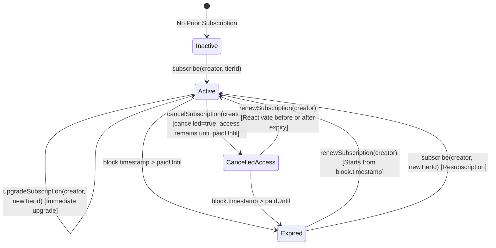

# PatronChain — Architecture & System Design

## 1. Executive Summary

PatronChain is an on-chain recurring membership infrastructure native to **BOT Chain** (SocialFi + PayFi). It enables creators to establish decentralized recurring revenue streams and allows supporters to purchase verifiable, time-bound memberships paid in native **BOT**.

The system replaces off-chain subscription platforms (e.g., Patreon, Substack, OnlyFans) with an immutable, transparent smart contract that functions as the single source of truth for creator metadata, membership tiers, subscription lifecycles, and fee accounting.

---

## 2. Core Primitives

### 2.1 Time-Bound Entitlement
Membership is not represented by a fragile boolean or centralized database flag. Instead, it is defined by a deterministic timestamp formula:
$$\text{active} = (\text{block.timestamp} \le \text{paidUntil}) \land (\text{tierId} \neq 0)$$

Key properties:
- **Continuous Access**: Cancelling a membership revokes future auto-renewal intent, but guarantees uninterrupted access until `paidUntil`.
- **Deterministic Renewal**: Renewing before expiration adds duration directly to the existing `paidUntil`:
  $$\text{paidUntil}_{\text{new}} = \text{paidUntil}_{\text{prev}} + \text{duration}$$
  Renewing after expiration restarts from current block time:
  $$\text{paidUntil}_{\text{new}} = \text{block.timestamp} + \text{duration}$$
- **Immediate Upgrade**: Supporters can upgrade to higher tiers instantly. The new tier's duration begins immediately, establishing a new `paidUntil` cycle.

### 2.2 Native BOT PayFi Engine
- All payments (subscriptions, renewals, upgrades, and direct tips) are settled in native **BOT** tokens (`msg.value`).
- **Platform Fee**: Default is 250 basis points (2.5%), strictly capped by contract invariants at 1000 basis points (10.0%).
- **Split Calculation**:
  $$\text{fee} = \frac{\text{grossPayment} \times \text{feeBasisPoints}}{10000}$$
  $$\text{creatorCredit} = \text{grossPayment} - \text{fee}$$
- **Pull-Payment Pattern**: Creator earnings and platform fees are credited to segregated internal balances. Funds are never pushed to untrusted recipient addresses during payment execution, eliminating denial-of-service (DoS) and reentrancy vectors.

---

## 3. High-Level System Architecture

```mermaid
graph TD
    subgraph Client Application [Vite + React + Viem Frontend]
        UI[User Interface & Neo-Brutalist Components]
        WalletMgr[Wallet Provider & Network Switcher]
        ContractService[PatronChain Service Layer]
        VerifierService[Public Verification Service]
        EventService[On-Chain Event Querying]
    end

    subgraph BOT Chain Infrastructure [EVM Compatible]
        RPC[BOT Chain RPC Node]
        Explorer[Botscan / Bohr Explorer]
    end

    subgraph Smart Contract Layer [PatronChain.sol]
        Registry[Creator Registry & Metadata]
        TierEngine[Tier Management Engine]
        SubEngine[Subscription Lifecycle Engine]
        Vault[Segregated Earnings & Fee Vault]
    end

    UI --> WalletMgr
    WalletMgr --> ContractService
    ContractService --> RPC
    VerifierService --> RPC
    EventService --> RPC
    RPC --> Smart Contract Layer
    RPC --> Explorer
```

---

## 4. Smart Contract Component Breakdown

### 4.1 Creator Registry
- **Creator Registration**: Any address can register with a unique handle, display name, description, avatar URI, and category.
- **Handle Collision Prevention**: Handles are indexed via lowercase keccak256 hash mappings (`handleToCreator[keccak256(bytes(lowerHandle))]`). Duplicate registration of identical handles (case-insensitive) is rejected.
- **Creator Metadata**: Creators retain full control over their public profile and can update metadata anytime without affecting active subscriptions.

### 4.2 Tier Management
- **Tier Configuration**: Creators can deploy multiple tiers per account. Each tier specifies:
  - `pricePerPeriod`: Price in native BOT wei.
  - `periodDuration`: Billing cycle length in seconds (e.g., 30 days = 2,592,000 seconds).
  - `name` & `description`: Metadata explaining tier benefits.
  - `active`: Boolean flag allowing creators to retire tiers while preserving existing subscriber rights.
- **Tier Isolation**: Subscribers cannot subscribe to an inactive tier, but existing subscriptions continue until their expiration.

### 4.3 Subscription Engine
- **Composite Key**: Subscriptions are keyed by `keccak256(abi.encodePacked(subscriber, creator))`. Each supporter maintains exactly one active subscription relationship per creator, ensuring clear access hierarchy.
- **State Fields**:
  - `tierId`: The currently subscribed tier index.
  - `paidUntil`: Unix timestamp when entitlement ends.
  - `cancelled`: Flag indicating user cancellation.
  - `totalPaid`: Cumulative native BOT paid to this creator.
  - `lastPaymentTime`: Timestamp of latest transaction.

### 4.4 Vault & Accounting Engine
- Segregates creator funds (`creatorBalances[creator]`) from accumulated protocol fees (`accumulatedPlatformFees`).
- Pull-based withdrawals via `withdrawEarnings()` and `withdrawPlatformFees()`.
- Reentrancy protection via OpenZeppelin `ReentrancyGuard`.
- State mutation strictly precedes native transfer (`Checks-Effects-Interactions`).

---

## 5. State Transition Machine



---

## 6. Security Architecture

1. **Reentrancy Immunity**: All state-modifying external functions utilize OpenZeppelin's `ReentrancyGuard`.
2. **Access Control**: Platform governance is secured with OpenZeppelin's `Ownable2Step`, eliminating single-step ownership transfer hazards.
3. **Emergency Circuit Breaker**: OpenZeppelin's `Pausable` enables protocol pausing in case of critical upstream network anomalies.
4. **Pull Over Push**: No native BOT transfers are performed during subscription or tipping workflows. Balance updates are strictly internal.
5. **No Token Wrapping Required**: Operates directly with native BOT (`msg.value`), avoiding ERC20 approval phishing vectors and allowance exhaustion bugs.
