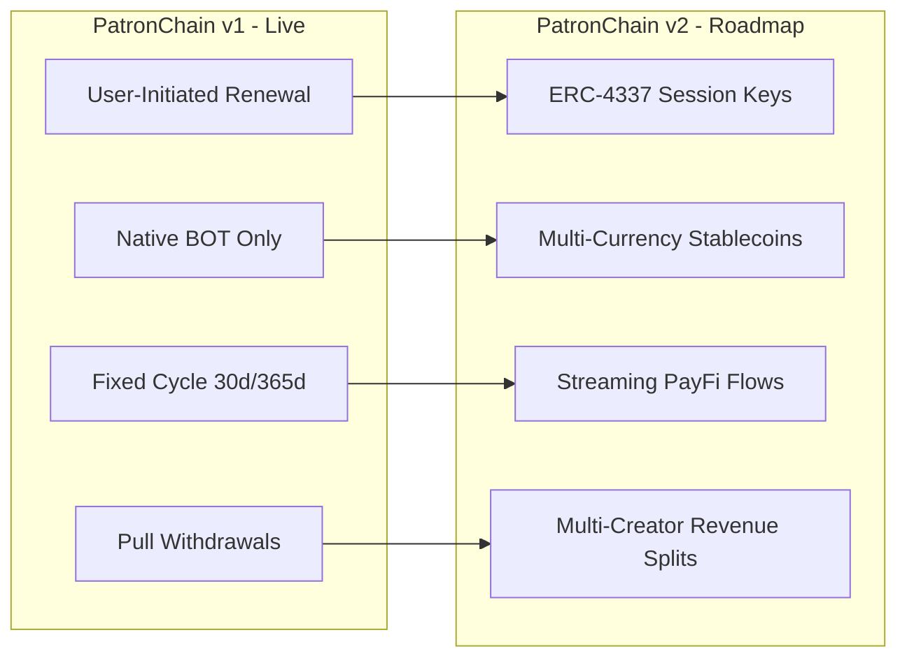

# PatronChain — Known Limitations & Architectural Decisions

## 1. Architectural Scope & Trade-offs (Version 1)

PatronChain v1 is intentionally designed with simplicity, security, and gas efficiency at its core. To maximize auditability and eliminate complex failure modes on BOT Chain, several explicit architectural choices were made.

---

### 1.1 User-Initiated Recurring Renewals
- **Current Behavior**: Supporters must sign an on-chain transaction to renew their subscription before or after expiration.
- **Rationale**: Standard EVM accounts (EOAs) cannot be unilaterally debited by external contracts without prior ERC-20 allowance and keeper infrastructure. PatronChain operates directly with native **BOT** tokens (`msg.value`), which cannot be pulled asynchronously without account abstraction.
- **Mitigation & Experience**:
  - The UI tracks time-to-expiry with high-visibility countdown indicators.
  - Supporters can renew at any time; renewing early strictly adds duration to `paidUntil` without penalty.
  - Cancelling does not revoke access immediately—it guarantees access until `paidUntil` while stopping user renewal prompts.
- **v2 Roadmap**: Native integration with ERC-4337 smart contract accounts and recurring session keys for automated debit allowances.

---

### 1.2 Native BOT Exclusivity
- **Current Behavior**: Subscriptions, renewals, upgrades, and tips are accepted strictly in native BOT (`msg.value`).
- **Rationale**:
  - Eliminates the two-step `approve()` + `transferFrom()` user friction that causes 40%+ drop-off in Web3 checkouts.
  - Avoids ERC-20 infinite allowance security risks and phishing vectors.
  - Guarantees zero reentrancy or fee-on-transfer idiosyncrasies associated with non-standard ERC-20 implementations.
- **v2 Roadmap**: Support for multi-currency PayFi vaults accepting bridged stablecoins (e.g. USDT, USDC on BOT Chain) using Uniswap Permit2.

---

### 1.3 Single Tier per Creator-Supporter Pair
- **Current Behavior**: A supporter holds exactly one active subscription tier per creator.
- **Rationale**:
  - Keying subscriptions by `keccak256(subscriber, creator)` creates a simple, predictable state model: $O(1)$ lookup complexity for third-party dApp verification.
  - Prevents accidental duplicate payments or confusion over conflicting entitlement tiers.
- **Mitigation**: Upgrades are fully supported. Moving from Tier 1 to Tier 2 immediately promotes the subscriber to the higher tier's access level.

---

### 1.4 Immediate Upgrade Semantics
- **Current Behavior**: Upgrades take effect immediately, starting a new full billing cycle at the new tier's duration upon payment of the new tier's full price.
- **Rationale**:
  - Dynamic micro-prorating on-chain introduces rounding errors, dust accumulations, and potential arbitrage vectors where users game fluctuating price periods.
  - Clear, discrete transactions maintain strict invariant accounting: every payment satisfies $\text{fee} + \text{net} = \text{gross}$.
- **Transparency**: The user interface provides full advance disclosure before upgrade confirmation.

---

### 1.5 Creator Pull-Withdrawal Pattern
- **Current Behavior**: Creator earnings accumulate inside `creatorBalances[creator]` and must be explicitly withdrawn via `withdrawEarnings()`.
- **Rationale**:
  - Direct push payments during subscriber checkouts are an anti-pattern that exposes subscribers to creator contract reverts (Denial-of-Service) and gas-limit griefing.
  - The pull pattern is mathematically isolated and reentrancy-guarded.

---

## 2. Summary of v2 Evolution Roadmap

